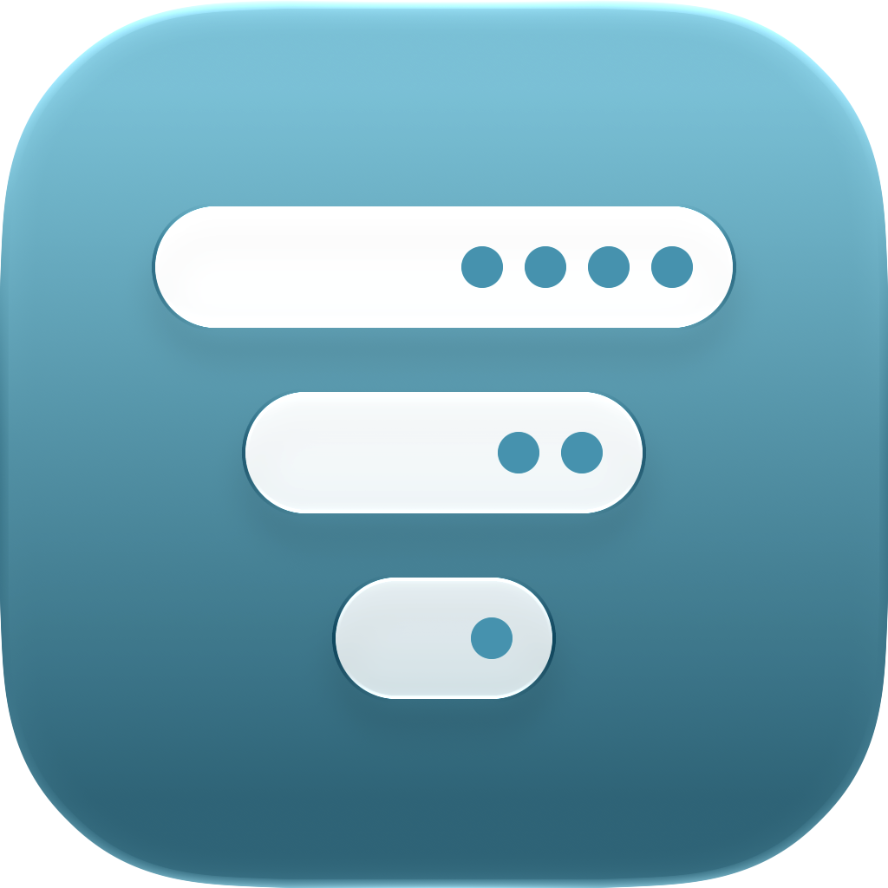

<div align="center">
  <picture>
    <source media="(prefers-color-scheme: dark)" srcset="Design/AppIcon-Dark.png">
    
  </picture>
  <h1>CleanBar</h1>
  <p><strong>Un organizador sencillo de la barra de menús para macOS.</strong></p>
  <p>
    
    
    
    
  </p>
  <p>🇬🇧 <a href="README.md">Read in English</a></p>
</div>

---

CleanBar vive en tu barra de menús y oculta los iconos que no necesitas ver todo el tiempo: los de otras apps y los del propio macOS (Wi‑Fi, Bluetooth, Brillo del teclado…). Los iconos ocultos no se mostrarán en la barra de menús. Haz clic en el icono de CleanBar y aparecerán; vuelve a hacer clic y desaparecen.

Hecha de forma nativa para macOS 27+ con SwiftUI y AppKit.

## Instalación

Descarga el último `.dmg` de la [página de Releases](https://github.com/juancarloslopez3/CleanBar/releases), ábrelo y arrastra **CleanBar** a tu carpeta Aplicaciones.

CleanBar tiene que ejecutarse desde **Aplicaciones**: macOS solo reconoce los iconos de la barra de menús de las apps que están en /Applications o /Library. Si se ejecuta desde otro sitio, CleanBar no podrá ocultar los iconos.

> [!IMPORTANT]
> La app está firmada localmente y no con un certificado de pago de Apple Developer, así que macOS bloquea la primera apertura. Para permitirla: abre **Ajustes del Sistema → Privacidad y seguridad**, desplázate hasta el aviso sobre CleanBar y haz clic en **Abrir igualmente**. Solo tienes que hacerlo una vez por versión.

Después, la primera vez que la abras:

1. **Permite Accesibilidad** (obligatorio) y **Grabación de pantalla** (para las imágenes de los iconos) en el panel **Permisos** de CleanBar. Haz clic en **Permitir**: Ajustes del Sistema se abre en la sección correcta, con el icono de CleanBar en un panel flotante. Arrastra el icono a la lista y listo.
2. **Sal de Bartender, Ice, Hidden Bar o Dozer** si los usas. Dos organizadores se pelean por los mismos iconos.
3. **Elige qué ocultar.** Haz clic derecho en el icono de CleanBar → **Editar la barra de menús** y arrastra iconos a **Ocultos**. No se oculta nada hasta que lo hagas.

CleanBar es un agente de la barra de menús: después de abrirla, búscala en la barra de menús, no en el Dock.

## Funciones

- **Oculta cualquier icono** — los de otras apps y los del propio macOS: Wi‑Fi, Bluetooth, Batería, Sonido, Pantalla, Brillo del teclado, Duplicar pantalla y Centro de control. El reloj siempre será visible.
- **Un clic para mostrarlos** — haz clic en el icono de CleanBar o pulsa tu atajo. Los iconos ocultos se despliegan desde él uno tras otro y se ocualtan al terminar, pueden volver a ocultarse solos tras 1 a 60 segundos.
- **Barra flotante** — o deja los iconos ocultos fuera de la barra de menús y muéstralos en una barra bajo el icono de CleanBar. Haz clic en uno para abrir su menú: el icono vuelve a la barra de menús hasta que el menú se cierra.
- **Espacio vacío de la barra de menús** — muestra los iconos ocultos pasando el puntero o haciendo clic sobre una parte vacía de la barra de menús. Así puedes ocultar también el propio icono de CleanBar.
- **Editor de la barra de menús** — arrastra imágenes de tus iconos entre **Visibles** y **Ocultos**, o unas sobre otras para reordenar la barra de menús. CleanBar mueve los iconos por ti.
- **Iconos nuevos** — el marcador *Aquí aparecen los iconos nuevos* decide dónde van los iconos de las apps recién instaladas, incluso puedes poner que directamente a vayan a **Ocultos**.
- **A tu gusto** — cinco símbolos para el icono (círculo, tres puntos, punto, estrella, flecha), aspecto claro, oscuro o automático, y apertura al iniciar sesión.
- **Inglés y español** — Por defecto sigue el idioma de tu Mac, o elige uno en Ajustes → General.

## Privacidad

- **Todo se queda en tu Mac.** Sin red, sin analíticas, sin cuentas. Los ajustes se guardan en local, y las imágenes de los iconos para la barra flotante se guardan en caché en `~/Library/Caches/com.cleanbar.CleanBar`.
- **Accesibilidad** se usa para encontrar los iconos de la barra de menús y moverlos, igual que harías tú con <kbd>⌘</kbd> y arrastrar.
- **Grabación de pantalla** se usa solo para captar los iconos de la barra de menús para el editor y la barra flotante. CleanBar capta la barra de menús y nada más.
- **Al salir de CleanBar vuelven todos los iconos a la normalidad.**

## Atajos

| Acción | Atajo |
|---|---|
| Mostrar u ocultar los iconos ocultos | Clic en el icono de CleanBar, o tu atajo |
| Abrir el menú de CleanBar (Editar la barra de menús · Ajustes · Salir) | Clic derecho o <kbd>⌃</kbd>-clic en el icono de CleanBar |
| Mostrar los iconos ocultos sin el icono de CleanBar | Pasar el puntero o hacer clic sobre un espacio vacío de la barra de menús (opcional) |
| Abrir los ajustes con el icono de CleanBar oculto | Volver a abrir CleanBar desde Spotlight o Aplicaciones |
| Atajo para mostrar / ocultar | Configurable en Ajustes → General |

## Limitaciones conocidas

- **Por app** — los iconos de una app se ocultan juntos. Los iconos del propio macOS se ocultan uno a uno, pero solo los de la lista de arriba; otros (Concentración, Ahora suena…) no se pueden ocultar.
- **Apps fuera de /Applications y /Library** — macOS no las distingue, así que sus iconos se ocultan siempre que CleanBar oculta iconos. El editor te dice cuáles son.
- **El Centro de notificaciones** no se abre por sí solo mientras hay iconos ocultos. CleanBar recoge tu clic en el reloj y lo abre por ti, así que los iconos ocultos pueden verse por un instante.
- **Barras de menús llenas** — si los iconos que dejas visibles no caben, macOS sigue poniendo algunos detrás de su botón («).
- **Las imágenes de la barra flotante no son en directo** — un icono que cambia solo (una gráfica de CPU, un temporizador) se ve como estaba la última vez que CleanBar lo vio. La primera vez que se abre una app con iconos ocultos, su icono aparece en la barra de menús durante un segundo para que CleanBar lo capte.

## Compilar desde el código

Necesita **macOS 27+** y **Xcode 27+**.

```bash
open CleanBar.xcodeproj   # y después ⌘R en Xcode
```

O compila desde la línea de comandos:

```bash
xcodebuild -project CleanBar.xcodeproj -scheme CleanBar -destination 'platform=macOS' build
```

Las compilaciones Debug se instalan directamente en `/Applications/CleanBar.app` y se ejecutan desde ahí, porque macOS solo reconoce los iconos de la barra de menús de las apps que están en /Applications. Cada compilación local tiene una firma nueva, así que macOS vuelve a pedir los permisos; CleanBar borra por ti las entradas antiguas.

CleanBar es un agente de la barra de menús (`LSUIElement`): después de abrirla, búscala en la barra de menús, no en el Dock.

## Arquitectura

- **La lista de apps permitidas de la barra de menús de macOS 27** — `IconHider` incluye todas las apps e iconos del sistema salvo los ocultos mediante `MBAssessmentModeAssertion`, una API privada de MenuBarClientCore pensada para apps de exámenes (Bartender 7 también la usa), y rehace la lista cuando se abren apps.
- **Accesibilidad** — `MenuBarScanner` lee los iconos y dónde están, `ItemMover` los mueve con eventos de <kbd>⌘</kbd> y arrastrar, e `ItemImageCapture` los capta de la ventana de la barra de menús del Window Server.
- **Ajustes en SwiftUI** con paneles al estilo de Ajustes del Sistema, y AppKit (`NSStatusItem`, `NSPanel`) para el icono de CleanBar, la barra flotante y el panel de permisos.
- **Swift 6** con `MainActor` como aislamiento por defecto.
- **`AppSettings` `@Observable`** guardado en `UserDefaults`, y una hot key de Carbon para el atajo global (sin permisos extra).
- **String Catalog** (`Localizable.xcstrings`) para la traducción al español.

## Licencia

CleanBar se publica bajo la [licencia MIT](LICENSE).

---

<div align="center">Hecho por <a href="https://github.com/juancarloslopez3">Juan Carlos López</a></div>
