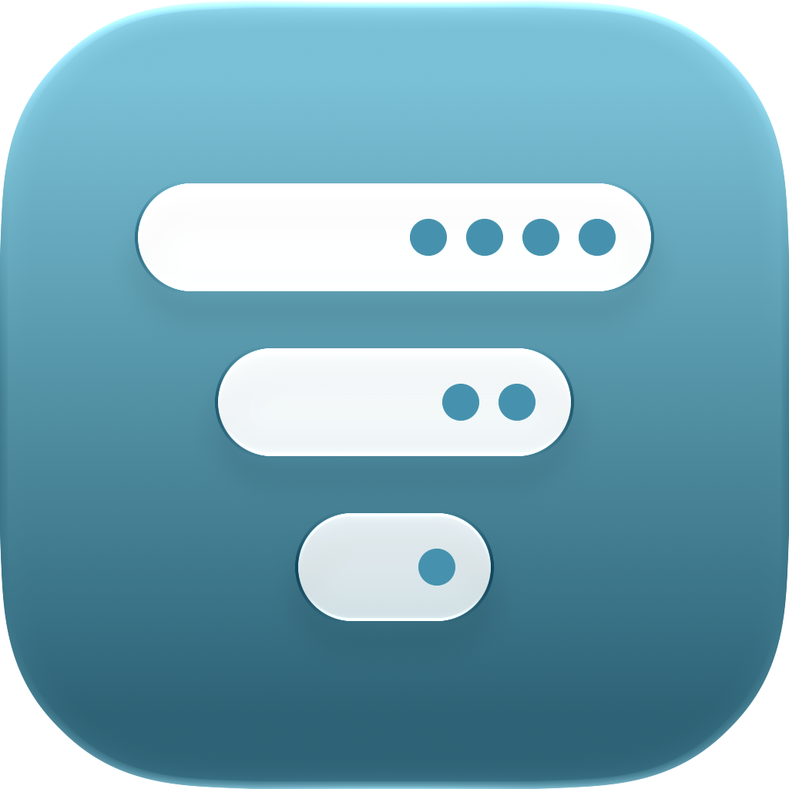

<div align="center">
  <picture>
    <source media="(prefers-color-scheme: dark)" srcset="Design/AppIcon-Dark.png">
    
  </picture>
  <h1>CleanBar</h1>
  <p><strong>A simple menu bar organizer for macOS.</strong></p>
  <p>
    
    
    
    
  </p>
  <p>🇪🇸 <a href="README.es.md">Leer en español</a></p>
</div>

---

CleanBar lives in your menu bar and hides the icons you don't need to see all the time: other apps' icons and macOS's own (Wi‑Fi, Bluetooth, Keyboard Brightness…). Hidden icons leave the menu bar completely. Click CleanBar's icon and they come back where they were; click again and they're gone. It can also show your Mac's temperature, with a history of every sensor, and set the speed of its fans.

Built natively for macOS 27+ with SwiftUI and AppKit.

## Install

Download the latest `.dmg` from the [Releases page](https://github.com/juancarloslopez3/CleanBar/releases), open it, and drag **CleanBar** into your Applications folder.

CleanBar has to run from **Applications**: macOS only recognizes menu bar icons of apps in /Applications or /Library. Run from anywhere else, CleanBar won't hide anything and tells you why.

> [!IMPORTANT]
> The app is signed locally rather than with a paid Apple Developer certificate, so macOS blocks the first launch. To allow it: open **System Settings → Privacy & Security**, scroll down to the notice about CleanBar, and click **Open Anyway**. You only need to do this once per version.

Then, on first launch:

1. **Allow Accessibility** (required) and **Screen Recording** (for pictures of the icons) in CleanBar's **Permissions** pane. Click **Allow**: System Settings opens at the right list, with CleanBar's icon in a panel below its window. Drag the icon into the list and you're done.
2. **Quit Bartender, Ice, Hidden Bar or Dozer** if you use them. Two organizers fight over the same icons.
3. **Choose what to hide.** Right-click CleanBar's icon → **Edit Menu Bar Layout** and drag icons to **Hidden**. Nothing is hidden until you do.

CleanBar is a menu-bar agent: after launch, look for it in the menu bar, not the Dock.

## Features

- **Hide any icon** — other apps' icons, plus macOS's own: Wi‑Fi, Bluetooth, Battery, Sound, Display, Keyboard Brightness, Screen Mirroring and Control Center. CleanBar's own temperature hides too. The clock always stays.
- **One click to show them** — click CleanBar's icon or press your shortcut. Hidden icons unfold from it one after another and fold back in when you're done, and can hide again by themselves after 1 to 60 seconds.
- **Floating bar** — or keep hidden icons out of the menu bar and show them in a glass bar below CleanBar's icon. Click one to open its menu: the icon comes back in the menu bar until the menu closes.
- **Empty menu bar space** — show the hidden icons by hovering over or clicking an empty part of the menu bar. With that, you can hide CleanBar's own icon too.
- **Layout editor** — drag pictures of your icons between **Shown** and **Hidden**, or to any place in a row, either end included, to reorder the menu bar. CleanBar moves the real icons for you.
- **New icons** — the *New icons appear here* marker decides where icons of newly installed apps go, including straight into Hidden.
- **Temperature in the menu bar** — turn it on under **Settings → Sensors**, and pick which sensor it shows, its color and its size. Or show just an icon to save CPU: the sensors are then read every 30 seconds instead of every 5.
- **Every sensor** — click the temperature to see all the sensors and fans, with the ones you want, in the order you want. Rest the pointer on one for its history over the last hour, day, week or month.
- **Fan control** — rest the pointer on **Fans** to set their speed with sliders, pick a profile (25%, 50%, 75% and 100% to start with, and your own, with the names you like), or leave it to macOS as usual.
- **Fan rules** — run the fans at a profile when a sensor goes over a temperature, or by what the Mac is up to: charging, on battery, plugged in, in Low Power Mode, with its lid closed or overheating. A default setting decides what the fans do when CleanBar opens.
- **Make it yours** — five icon symbols (circle, three dots, dot, star, arrow), light, dark or automatic appearance, and open at login.
- **English and Spanish** — follows your Mac's language, or pick one in Settings → General.

## Privacy

- **Everything stays on your Mac.** No analytics, no accounts. The only thing CleanBar asks the internet is whether there's a newer version: once every 30 days it reads the latest release on GitHub, and downloads it only if you say so. Settings are stored locally, icon pictures for the floating bar are cached in `~/Library/Caches/com.cleanbar.CleanBar`, and the sensors' history is kept in `~/Library/Application Support/com.cleanbar.CleanBar`.
- **Accessibility** is used to find the menu bar icons and move them, the same way you would with <kbd>⌘</kbd>-drag.
- **Screen Recording** is used only to picture the menu bar icons for the editor and the floating bar. CleanBar captures the menu bar and nothing else.
- **Your password** is only asked for to set a fan's speed, the first time. Only administrators can change the fans, so that installs a small helper that runs as root (`/Library/PrivilegedHelperTools/com.cleanbar.CleanBar.FanHelper`, and its entry in `/Library/LaunchDaemons`). All it can do is set the fans within their own limits and give them back to macOS, and it only runs while the fans are set to a speed. **Settings → Sensors → Remove Helper** takes it off your Mac.
- **Quitting CleanBar brings every icon back**, and gives the fans back to macOS, even if CleanBar crashed.

## Shortcuts

| Action | Shortcut |
|---|---|
| Show or hide the hidden icons | Click CleanBar's icon, or your shortcut |
| Open CleanBar's menu (Edit Menu Bar Layout · Settings · Quit) | Right-click or <kbd>⌃</kbd>-click CleanBar's icon |
| Show the hidden icons without CleanBar's icon | Hover over or click an empty space in the menu bar (optional) |
| Open Settings while CleanBar's icon is hidden | Open CleanBar again from Spotlight or Applications |
| Show / hide shortcut | Configurable in Settings → General |
| See the sensors and fans | Click the temperature in the menu bar |
| See the history of a sensor or a fan | Rest the pointer on its row, or click it |
| Set the fans | Rest the pointer on **Fans** at the top of the list, or click it |
| Rename or delete a fan profile you added | Select it in Settings → Sensors and press <kbd>Return</kbd>, or right-click it |

## Known limitations

- **Per app** — an app's icons hide together. macOS's own icons hide one by one, but only those listed above; others (Focus, Now Playing…) can't be hidden.
- **Apps outside /Applications and /Library** can't be told apart by macOS, so their icons hide whenever CleanBar hides icons. The editor names them.
- **Notification Center** won't open on its own while icons are hidden. CleanBar catches your click on the clock and opens it for you, so hidden icons may twitch for a moment.
- **Crowded menu bars** — if the icons you keep don't fit, macOS still puts some behind its button («).
- **Floating bar pictures aren't live** — an icon that changes by itself (a CPU graph, a timer) looks the way it did when CleanBar last saw it. The first time an app with hidden icons opens, its icon shows in the menu bar for about a second so CleanBar can picture it.
- **Sensors and fans aren't documented by Apple** — which sensor is which comes from what people have worked out, chip by chip, so names can be off and a chip newer than CleanBar may show fewer sensors. A macOS update could change how fans are controlled.
- **One fan app at a time** — if another app (iStat Menus, Macs Fan Control…) is setting the fans, CleanBar says so and leaves them to it. Turn off its fan control to use CleanBar's.
- **History has gaps** — the sensors are only read while the Mac is awake, CleanBar is open and the setting is on.

## Building from source

Requires **macOS 27+** and **Xcode 27+**.

```bash
open CleanBar.xcodeproj   # then ⌘R in Xcode
```

Or build from the command line:

```bash
xcodebuild -project CleanBar.xcodeproj -scheme CleanBar -destination 'platform=macOS' build
```

Debug builds install straight into `/Applications/CleanBar.app` and run from there, since macOS only recognizes menu bar icons of apps in /Applications. Each local build has a new signature, so macOS asks for the permissions again; CleanBar clears the stale entries for you.

CleanBar is a menu-bar agent (`LSUIElement`): after launch, look for it in the menu bar, not the Dock.

## Architecture

- **macOS 27's menu bar allowlist** — `IconHider` lists every app and system icon except the hidden ones through `MBAssessmentModeAssertion`, a private MenuBarClientCore API meant for exam apps (Bartender 7 uses it too), and rebuilds the list as apps launch.
- **Accessibility** — `MenuBarScanner` reads the icons and where they are, `ItemMover` moves them with <kbd>⌘</kbd>-drag events, and `ItemImageCapture` pictures them from the Window Server's menu bar window.
- **SwiftUI-first** settings with System Settings-style panes, and AppKit (`NSStatusItem`, `NSPanel`) for CleanBar's icon, the floating bar and the permission panel.
- **Sensors** — `SMC` reads the System Management Controller through IOKit, which takes no permission, `SensorMonitor` keeps the latest values and `SensorHistory` averages them into a small SQLite database, with a table of keys per chip in `SensorCatalog` (thanks to [Stats](https://github.com/exelban/stats)).
- **Fans** — writing to the SMC takes root, so `FanController` talks over XPC to the `FanHelper` tool, a launchd daemon started on demand. It takes only bounded fan speeds, never arbitrary SMC writes, and gives the fans back to macOS when CleanBar disconnects. It's installed with an administrator's password, as `SMAppService` and `SMJobBless` need a Developer ID.
- **Swift 6** with `MainActor` as the default isolation.
- **`@Observable` `AppSettings`** stored in `UserDefaults`, and a Carbon hot key for the global shortcut (no extra permission).
- **String Catalog** (`Localizable.xcstrings`) for the Spanish translation.

## License

CleanBar is released under the [MIT License](LICENSE).

---

<div align="center">Made by <a href="https://github.com/juancarloslopez3">Juan Carlos López</a></div>
